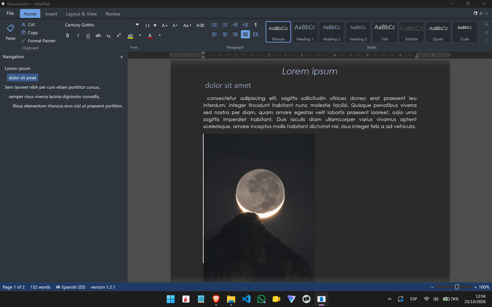

# MiniPad

A lightweight Microsoft Word–style word processor written in Rust with
egui/eframe. It opens, edits and saves real `.docx` files without losing their
content.

**Current version:** 1.2.1 · **Platform:** Windows 10/11


## Highlights

- **WYSIWYG page view** with margins, a ruler whose indent markers can be
  dragged, zoom and formatting marks; Light, Dark and Custom themes.
- **Rich formatting:** installed and Office cloud fonts, size,
  bold/italic/underline, colours, highlights, caps, sub/superscript, styles and
  multi-level Word lists.
- **Paragraphs:** alignment, left/right/first-line and hanging indents, line
  spacing, spacing before/after, tab stops, borders, shading and pagination
  rules.
- **Tables:** insert, resize, borders, shading, styles, merged cells, one level
  of nested tables editable in place, and floating tables with text wrapping.
- **Objects:** inline and floating pictures with text wrapping, hyperlinks,
  page/line/column breaks, symbols and date/time.
- **Review:** tracked changes, comments beside the page, Accept All / Reject All,
  and a Hunspell spell checker with bundled `en_US` and `es_ES` dictionaries.
- **Layout:** headers and footers per section, footnotes and endnotes, sections
  and multiple balanced columns.
- **Files:** lossless `.docx` round-trips, native `.fwd`, plain text, HTML export
  and PDF export with embedded subset fonts.
- **Safety and navigation:** configurable autosave recovery, a startup Restore
  prompt after a crash, and a navigation pane built from heading styles.
- **Clipboard:** rich internal copy/paste of paragraphs, pictures and whole
  tables; Ctrl+V also accepts HTML tables, images and tab-separated text from
  other applications, while Ctrl+Shift+V pastes plain text.

## Requirements

- Windows 10 or 11.
- Rust 1.85 or newer.
- The GNU toolchain plus MinGW-w64 (`dlltool`/`as` are needed by the Windows
  crates).

## Build and run

```powershell
winget install Rustlang.Rustup
rustup default stable-x86_64-pc-windows-gnu
winget install BrechtSanders.WinLibs.POSIX.UCRT

.\build.ps1          # release build -> target\release\minipad.exe
.\build.ps1 -Run     # build and run
```

With the MSVC toolchain and Visual Studio Build Tools, plain
`cargo build --release` also works.

To try the bundled tour:

```powershell
.\target\release\minipad.exe "samples\Feature Tour.fwd"
```

## Command line

```
minipad.exe [file]                  open a document
minipad.exe --convert input output  convert (.docx/.fwd/.txt -> .docx/.fwd/.pdf/.html/.txt)
```

## Formats and data

- Opens `.docx`, `.fwd` (native JSON), `.txt`, `.md` and unknown text files.
- Saves `.docx`, `.fwd`, `.txt`; exports `.html` and `.pdf`.
- Preferences are stored in `%APPDATA%\MiniPad`.
- Additional Hunspell dictionaries can be placed in
  `%APPDATA%\MiniPad\dictionaries`.

## Known limitations

Text-box contents, shapes, charts, SmartArt and OLE objects are preserved and
positioned but shown as labelled placeholders. Tables nested more than one level
deep, or inside headers, footers, notes or text boxes, are display-only.
Per-change accept/reject is not implemented, and new comments cannot be added.
Different odd/even headers and RTL text are not supported.

## License

MiniPad is released under the MIT License; see [`LICENSE`](LICENSE).

The bundled English spell-checking dictionary comes from SCOWL/Hunspell and is
distributed under its own permissive licenses; see
[`assets/dictionaries/README_en_US.txt`](assets/dictionaries/README_en_US.txt).

The bundled Spanish dictionary comes from the LibreOffice/RLA-ES project and is
available under GPLv3+, LGPLv3+ or MPL 1.1+; MiniPad uses the MPL 1.1 option.
See [`assets/dictionaries/README_es_ES.txt`](assets/dictionaries/README_es_ES.txt)
and [`assets/dictionaries/LICENSE_es_ES.md`](assets/dictionaries/LICENSE_es_ES.md).

## Acknowledgments

This repository is built upon [FreeWord](https://github.com/gianpasd/FreeWord) by [gianpasd](https://github.com/gianpasd), which served as the foundation for these modifications.   